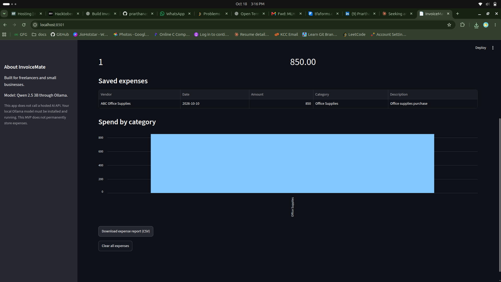
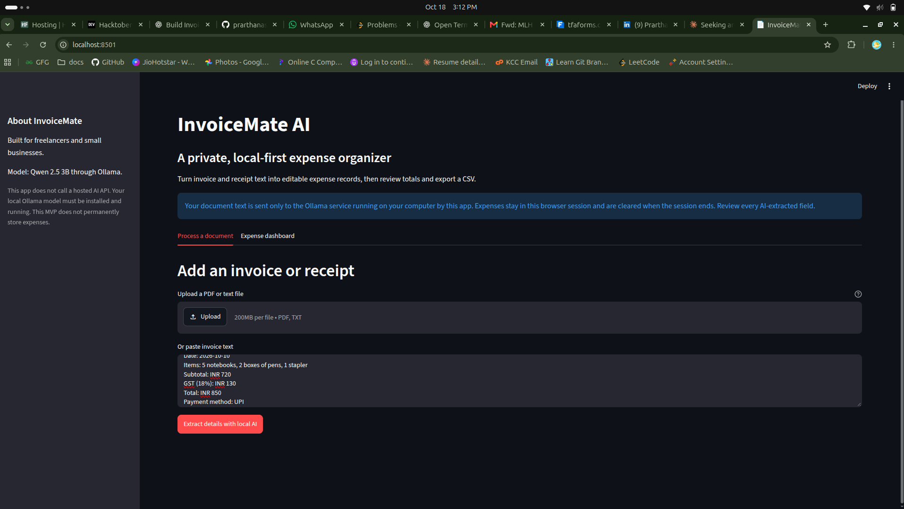
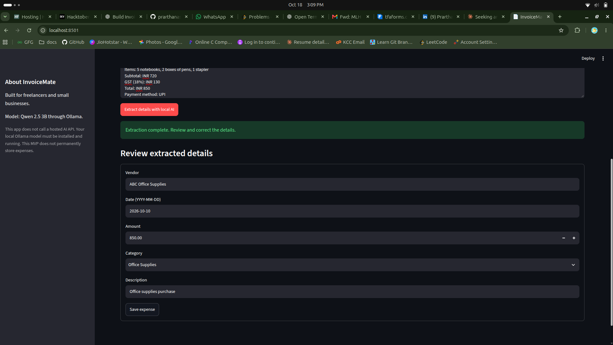

# InvoiceMate AI

InvoiceMate AI helps freelancers and small businesses turn invoice or receipt
text into editable expense records. Review the extracted vendor, date, amount,
category, and description, then view totals and export the records as CSV.

## Why local AI?

Invoice text can contain client names, addresses, and transaction details.
InvoiceMate sends the text only to Ollama at `localhost`, not to a hosted AI
API. Once the model has been downloaded, inference can run without an internet
connection. You can swap the model in `invoice_utils.py` without changing the
expense review and export flow.

This is an early MVP, not a secure accounting system. Expenses are held only
in Streamlit's current browser session; they are not saved to disk. Do not
deploy this app to a server if your goal is to keep documents on your own
computer. The current PDF reader supports selectable text, not scanned-image
OCR. Always verify AI output before using it for bookkeeping or taxes.

## Run it locally

1. Install [Ollama](https://ollama.com/) and download the model:

   ```bash
   ollama pull qwen2.5:3b
   ```

   Keep Ollama running. Its local API is normally available at
   `http://localhost:11434`.

2. Create and activate a virtual environment, then install the app:

   ```bash
   python -m venv .venv
   source .venv/bin/activate
   pip install -r requirements.txt
   ```

   On Windows PowerShell, activate with `.venv\Scripts\Activate.ps1`.

3. Start the app:

   ```bash
   streamlit run app.py
   ```

4. Upload a text-based PDF or TXT file, or paste invoice text. Review and
   correct the result before saving it. Use the dashboard to download a CSV.

For a model size that better fits your machine, update `MODEL` in
`invoice_utils.py` to another model supported by Ollama and pull that model
with `ollama pull <model-name>`.

## Tests

```bash
pip install -r requirements-dev.txt
pytest
```

The extraction tests mock Ollama; they do not require downloading a model or
starting the local service.

## Built with

- Python and Streamlit for the interface
- [Ollama](https://github.com/ollama/ollama) for local model serving
- Qwen 2.5 3B (Apache-2.0 model license) for invoice-field extraction
- pypdf and pandas for document text extraction and expense reports

## Hacktoberfest 2026 · Week 2: Side Hustle

This is a new, small-business-focused project for the
[Side Hustle challenge](https://dev.to/challenges/hacktoberfest-week2-2026-10-12).
Its open-weight model and local inference are the core of its privacy and
cost story: there is no per-document AI API bill, and the document text can
stay on the user's computer. A hosted API might be easier to set up, but it
would require sending financial documents to a service outside the user's
control and could add usage-based costs.

### Demo

InvoiceMate is intended to run locally for privacy; there is no hosted demo.
These screenshots show a sample receipt workflow in the running app:

#### Paste or upload a receipt



#### Review the AI-extracted details



#### Check the expense dashboard and export



### First user feedback

Add a real user's feedback here if someone tries the app. Do not claim a user,
payment, or testimonial unless it actually happened.

### DEV post checklist

- Publish one post for this challenge on DEV, including the required challenge
  submission statement and the `devchallenge` and `hf26challenge` tags.
- Include the repository link and a real demo or screenshot if available.
- Explain the local/open-weight model and why it matters for document privacy
  and predictable costs.
- Add genuine first-user feedback if you get it; otherwise leave that optional
  section out.
- List only partner prize categories whose technology you actually used. The
  challenge page lists no current categories in its fetched content, so verify
  the page again before claiming any.
- The challenge rules say projects and repositories must be new and created
  within the challenge window. Keep the creation history honest and check the
  exact deadline and eligibility rules on the official challenge page.

## License

MIT. See [LICENSE](LICENSE).
